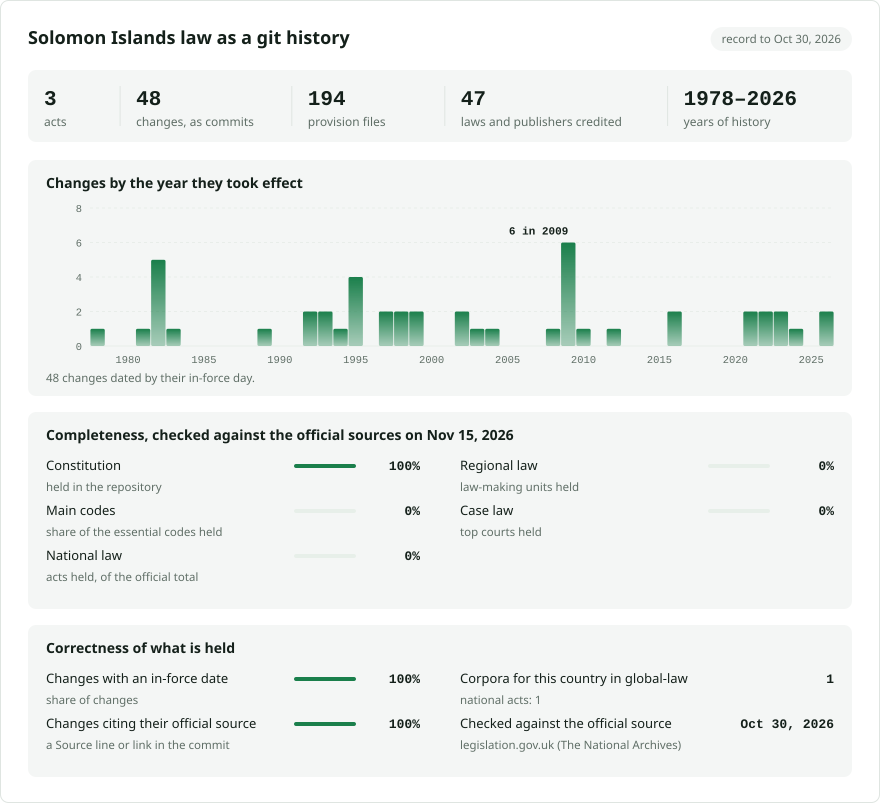

# Solomon Islands: law history in git

<picture>
<source media="(prefers-color-scheme: dark)" srcset="data/effort-dark.svg">

</picture>

The law of Solomon Islands as a git history: one file per section, one commit per version on the day it took effect, and the law that made each change as the commit's author. `git blame` names the law behind every line; `git log` lists every change to a section; picking a date gives the text this record holds for that day.

Part of [lexifina/global-law](https://github.com/lexifina/global-law), one git history for every country's law: this is the national law of Solomon Islands, which global-law reads at `solomon-islands/national/acts/`.

**What is in it now:** the Constitution, as made (1978) and as in force today; the Acts in force, among them the Penal Code, the Criminal Procedure Code, the Labour Act and the Companies Act 2009, as the Attorney-General reprints them (`chapters/<NNN>-<slug>/` for the Chapters of the 1996 Revised Edition, `acts/<year>/<NNN>-<slug>/` for later Acts); Acts of the National Parliament as passed, from the Parliament's own PDFs where the PDF has a text layer and an official source gives the day it commenced (see [`STRUCTURE.md`](STRUCTURE.md)); provincial ordinances (`provincial-ordinances/<year>/<slug>/`) and regulations, orders and other Legal Notices (`regulations/<year>/<slug>/`), each as its Gazette or Attorney-General PDF prints it where the PDF has a text layer and the instrument itself gives its commencement day; treaty actions; legal-system facts. [`constitution/README.md`](constitution/README.md) lists every provision of the Constitution.

Each provision is one file in `constitution/`: `sec-006.md` is section 6, protection from slavery and forced labour; `preamble.md` is the Preamble and `schedule-3.md` Schedule 3, the application of laws. Each treaty is one file in `un-treaties/`, named by its UN Treaty Collection reference (`untc-iv-11.md` is the Convention on the Rights of the Child).

The text is in English, the official language. legislation.gov.uk holds the Order only as an image-only scan, so the words of the 1978 version were read by optical character recognition (OCR); misreadings found by comparing it with the Attorney-General's reprint were corrected by an appended correction commit, and some may remain. Every later version is the Attorney-General's own text.

## Questions as git commands

| Question | Command |
| --- | --- |
| Every change to section 6 of the Constitution | `git log -p --word-diff -- constitution/sec-006.md` |
| Which law wrote each line of section 6? | `git blame constitution/sec-006.md` |
| Every version of section 6, with the day each took effect | `git log --format="%h %(trailers:key=In-force,valueonly,separator=) %an" -- constitution/sec-006.md` |
| Section 6 on 1 January 1980 | `python tools/on.py 1980-01-01 constitution sec-006` |

**Outside git**, we also host this record publicly, for free:

- **[Ask Claude about Solomon Islands law](https://global-law.lexifina.com/v1/try_claude?country=solomon-islands)**: opens Claude with a first question ready.
- **[Ask ChatGPT](https://global-law.lexifina.com/v1/try_chatgpt?country=solomon-islands)**: the same question in ChatGPT.
- **[Search Solomon Islands law on our site](https://lexifina.com/law?country=solomon-islands&q=forced+labour)**: a search for "forced labour", with each provision's text and its versions, no account needed.
- **[Developer REST API](https://global-law.lexifina.com/v1/search_law?query=forced+labour&jurisdiction=solomon-islands)**: the same search as JSON, with no key. See the [documentation here](https://lexifina.com/api/global-law).

Both assistants read the record through the free Global law connector (MCP, `https://global-law.lexifina.com/mcp`); the first time, the chat gives you the link that adds it. Ask in English.

**Host it yourself easily.** All it takes is git and Python, and the tools run on your machine:

```sh
git clone --depth 1 https://github.com/lexifina/global-law && cd global-law
python3 tools/countries.py add solomon-islands/national/acts
python3 tools/law.py show 1980-01-01 solomon-islands/national/acts/constitution/sec-006.md
```

Opened in Claude Code, Cursor, VS Code or Codex, the clone also starts a local MCP server with the same tools ([MCP.md](https://github.com/lexifina/global-law/blob/main/MCP.md)).

## Dates

Each commit is dated at noon, Pacific/Guadalcanal, on the day the version took effect, and carries it in its `In-force:` trailer:

- the Constitution's first version is dated 7 July 1978, the appointed day on which it came into effect (Order, sections 2(1) and 4(1)); its `Enacted:` trailer gives the day the Order was made (31 May 1978) and `Published:` 8 June 1978;
- each reprint of an Act in force (`Kind: consolidation`) is dated on its "as in force at" day when its endnotes give that day as the commencement of one of the Acts they list, or on 1 March 1996 for an Act unchanged since the 1996 Revised Edition; an Act as passed that leaves its commencement to the Gazette or a notice is dated by the day the Attorney-General's endnotes or Annual Index to the Gazette give;
- each treaty action is dated by the day the UN Treaty Collection gives for it, from 1981 to 2026;
- the legal-system facts are dated 30 October 2026, the day they were retrieved, because Wikidata gives only a year for the state's inception.

The Constitution's version is credited to the Order that made it (`S.I. 1978/783`), and tagged `constitution/1978-07-07` and `law/si-1978-783`; each treaty action is credited to itself (`Accession: …`), except the earliest, a 1981 succession, which opens the treaty record as its oldest version available, credited to the publisher.

## How it is checked

- `tools/check_repo.py` reads every version back from git on the day it took effect, and on the day before, and compares it, file by file, with the corpus it was built from (its sha256 is in [`data/corpus.sha256`](data/corpus.sha256)); every commit's trailers must parse.
- `tools/build.py` writes the history from that corpus in one pass, and the same corpus always gives the same commit hashes. [`REPRODUCE.md`](REPRODUCE.md) gives the builder's hashes and the OCR corrections made by hand; it does not yet record a check run or a second build.
- History is append-only: no merge commits, no rewriting, no commit dated in the future.
- [vulnerabilities/](vulnerabilities/): possible drafting mistakes in this law, found by global-law's detectors and checked by hand. Not run yet.

## What it does not show

- **Every version in between.** An Act in force is here as made or passed (where that text is available) and as in force today; the versions in between, one per amending Act, are not reconstructed.
- **Some Acts.** An Act as passed is held back when its PDF is an image-only scan (no OCR is run) or when no official source gives the day it commenced; a reprint is held back when the day it took its present form cannot be read from it. Repealed and spent Acts with no text layer are not here. Subsidiary legislation is here only where its PDF has a text layer and the instrument itself gives its commencement day (a stated day, assent, publication in the Gazette with the supplement's day, or the day printed in square brackets under the title); a Legal Notice with no commencement clause is dated on the day of its Gazette supplement. Court decisions are not here: the only source, PacLII, answers us with a Cloudflare 403 and is not worked around.
- **Headings.** The marginal notes (section headings), the chapter and part headings and the arrangement of sections are left out; footnotes are kept at the end of their section.
- **The Order itself.** Only its Schedule, the Constitution, is here, not the Order's own sections 1 to 14.
- **Every treaty.** The treaty actions come from a selected set of UN Treaty Collection status pages, and no treaty text is copied.

## Sources

| Source | Kind | Past versions | Notes |
| --- | --- | --- | --- |
| [legislation.gov.uk](https://www.legislation.gov.uk/uksi/1978/783/made) (The National Archives) | UK statutory instrument, as made: the Solomon Islands Independence Order 1978 | no, only as made | The Constitution is the Schedule to the Order; an image-only scan, read by OCR |
| [National Parliament of Solomon Islands](https://www.parliament.gov.sb/business/acts/) | Acts of Parliament as passed, 1981 to date (PDF) | no, as passed | Text from the PDF's own text layer; image-only scans are left out |
| [Attorney-General's Chambers](https://attorneygenerals.gov.sb/legislation/legislation-portal/) | Digital Legislation Reprints of the Acts in force and of the Constitution, published under the Legislation Act 2023 (PDF); Annual Indexes to the Gazette and Legal Notices, 1996 to 2024 | no, as in force at the reprint's day | Text from the PDF's own text layer; the endnotes and the indexes give the commencement days |
| [Attorney-General's Chambers: Gazettes and provincial ordinances](https://attorneygenerals.gov.sb/legislation-dashboard/) | Legal Notices from the Solomon Islands Gazette supplements; provincial ordinances (PDF) | no | Text from the PDF's own text layer; scans and garbled layers are left out |
| [FAOLEX (FAO)](https://faolex.fao.org/) | Regulations and orders of Solomon Islands, as secondary copies (`Source-status: secondary copy`) | no | Text from the PDF's own text layer |
| [UN Treaty Collection](https://treaties.un.org/) | Status of multilateral treaties deposited with the UN Secretary-General | each action on its own day | Facts only: the treaty, the action and its date |
| [Wikidata](https://www.wikidata.org/wiki/Q685) | Legal-system facts | no, as retrieved on 30 October 2026 | Form of government, institutions, official languages |

## Licence

See [`LICENSE`](LICENSE). The Constitution's text is taken from legislation.gov.uk and contains public sector information licensed under the Open Government Licence v3.0; the Acts are the official texts the National Parliament and the Attorney-General publish; the facts come from Wikidata (CC0 1.0) and the UN Treaty Collection, with no treaty text reproduced. Lexifina's own contributions (the history, commit messages, tables and tools) are dedicated to the public domain under CC0 1.0.

No AI model wrote or translated legal text; the text was read from the scan by OCR (Tesseract). The scripts were written by an AI model, which also made the hand corrections of OCR misreadings that [`REPRODUCE.md`](REPRODUCE.md) describes.

## Visualisations

- [visualisations/](visualisations/): charts drawn from this repository. Not drawn yet.

## More

From [lexifina/global-law](https://github.com/lexifina/global-law):

- [FEATURES.md](https://github.com/lexifina/global-law/blob/main/FEATURES.md): every feature, and what every corpus must support (`git blame`, `law.py`, the MCP tools)
- [FAQ.md](https://github.com/lexifina/global-law/blob/main/FAQ.md): questions and answers · [CONTRIBUTING.md](https://github.com/lexifina/global-law/blob/main/CONTRIBUTING.md): proposing changes · [MCP.md](https://github.com/lexifina/global-law/blob/main/MCP.md): the MCP server · [REPRODUCE.md](https://github.com/lexifina/global-law/blob/main/REPRODUCE.md): how it was built · [CHANGELOG.md](https://github.com/lexifina/global-law/blob/main/CHANGELOG.md)
- [FRESHNESS.md](https://github.com/lexifina/global-law/blob/main/FRESHNESS.md): how current each corpus is · [Monitoring](https://github.com/lexifina/global-law/tree/main/monitoring): whether updates are running · [WATCHING.md](https://github.com/lexifina/global-law/blob/main/WATCHING.md): how each official source is watched for changes
- [performance/](https://github.com/lexifina/global-law/tree/main/performance): how fast the tools are, measured
- [visualisations/](https://github.com/lexifina/global-law/tree/main/visualisations): charts and bridges across the world's law
- [Vulnerabilities](https://github.com/lexifina/global-law/tree/main/vulnerabilities): mistakes in legislation as published
